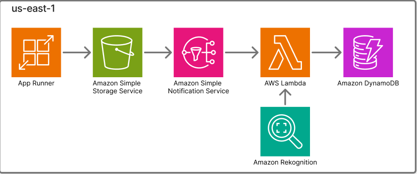

## module 1

內容: Amazon S3, Amazon SNS, AWS Lambda, Amazon DynamoDB, AWS App Runner, Amazon ECR, AWS IAM

需要的能力: 基礎 Dockerfile 建置能力, 基礎 IAM 權限與 Policy 配置, 基礎 Serverless 事件驅動 架構理解與除錯

## Objective

The goal of this challenge is to construct an event-driven, serverless AI image recognition pipeline consisting of a containerized frontend, cloud storage, a messaging service, a serverless backend worker, and a NoSQL database.

The source code for the frontend (Flask) and backend (Lambda) has been fully developed and provided to you. No code modification is required to complete this task. Your objective is to build, deploy, and configure the necessary AWS infrastructure, environment variables, and IAM permissions to ensure the pipeline operates smoothly.

In this pipeline, the frontend (AWS App Runner) allows users to upload images to Amazon S3. This action triggers a backend process (AWS Lambda) via Amazon SNS. The backend utilizes Amazon Rekognition to extract labels and stores the metadata in DynamoDB.

Note: Please refer to Table 1 for the required resource configuration.

Contestants must complete the following tasks:

 1. Create DynamoDB Table

- Create a DynamoDB table to store image recognition results.

- Please follow the configuration in Table 1 to create the table and partition key.

 2. Create Amazon S3 Bucket

- Create an Amazon S3 bucket for image storage.

- Ensure the bucket does not have public access enabled (Block all public access must be ON).

 3. Process Source Files and ECR

s3://aws-task1-source-code: This folder contains the complete and functional source code (app.py, Dockerfile, requirements.txt, lambda_worker.py). You only need to download these

files to your local environment or AWS Cloud9.

- Use the AWS CLI to authenticate with Amazon ECR.

- Build the container image using the provided Dockerfile and push it to your Private ECR repository.

 4. Configure AWS App Runner (Frontend)

- Deploy the container image pushed to ECR in Task 3 to AWS App Runner.

- Ensure that App Runner sets the target S3 bucket information via environment variables (UPLOAD_BUCKET and AWS_REGION).

- When a user submits an image through the web interface, the App Runner service needs to securely upload this file directly into the S3 bucket created in Task 2. You must configure an Instance Role for App Runner that grants it the necessary privileges to write objects into this specific bucket. If permissions are missing, the web interface will display an Access Denied error.

 5. Configure Amazon SNS

- Create a Standard Amazon SNS topic to act as a message broker.

- When a new image lands in the S3 bucket, the bucket needs to automatically broadcast a notification to your SNS topic. Modify the SNS Access Policy so that the Amazon S3 service has the authority to publish messages to this topic.

- To prevent the "confused deputy" security issue, ensure you use a Condition (such as aws:SourceArn) to restrict publishing permissions so that ONLY the specific S3 bucket created in Task 2 can send these notifications.

 6. Configure AWS Lambda and Connect to DynamoDB

- Create an AWS Lambda function using the provided lambda_worker.py.

- Ensure that Lambda sets the database connection information via environment variables (TABLE_NAME).

- Subscribe the Lambda function to the SNS topic created in Task 5.

- The Lambda function acts as the core AI engine. Upon receiving the SNS notification, it needs to perform three distinct actions:

- 1. Retrieve and read the uploaded image from the S3 bucket.

- 2. Send the image data to the Amazon Rekognition service to analyze and extract object labels.

- 3. Insert a new record containing the image ID and the generated labels into the DynamoDB table.

You must construct an Execution Role for the Lambda function that grants exactly the necessary permissions to successfully perform these three operations.

 7. Set Up S3 Event Notification & End-to-End Test

- Configure the S3 bucket to send an Event Notification to the SNS topic for all object creation events (s3:ObjectCreated:*).

- Access your App Runner public URL and upload an image. Verify that the image is stored in S3, and the AI-generated labels successfully appear in the DynamoDB table.

Contestants must complete all configurations as required and submit the final solution within the given timeframe.

*Table 1*

| Resource Category | Property | Value |
| --- | --- | --- |
| Amazon DynamoDB |   |   |
|   | Table Name | task1-ddb |
|   | Partition Key | ImageID (String) |
|   | Capacity Mode | On-demand |
|   | Region | us-east-1 |
| Amazon S3 |   |   |
|   | Bucket Name | task1-image-bucket- [random-id] |
|   | Block Public Access | On (True) |
|   | Region | us-east-1 |
| Amazon SNS |   |   |
|   | Topic Name | task1-topic |
|   | Type | Standard |

| AWS Lambda |   |   |
| --- | --- | --- |
|   | Function Name | task1-worker |
|   | Runtime | Python 3.9 or higher |
|   | Architecture | x86_64 |
|   | Timeout | 15 seconds |
| AWS App Runner |   |   |
|   | Service Name | task1-frontend |
|   | Port | 8080 |
|   | CPU & Memory | 1 vCPU, 2 GB |
